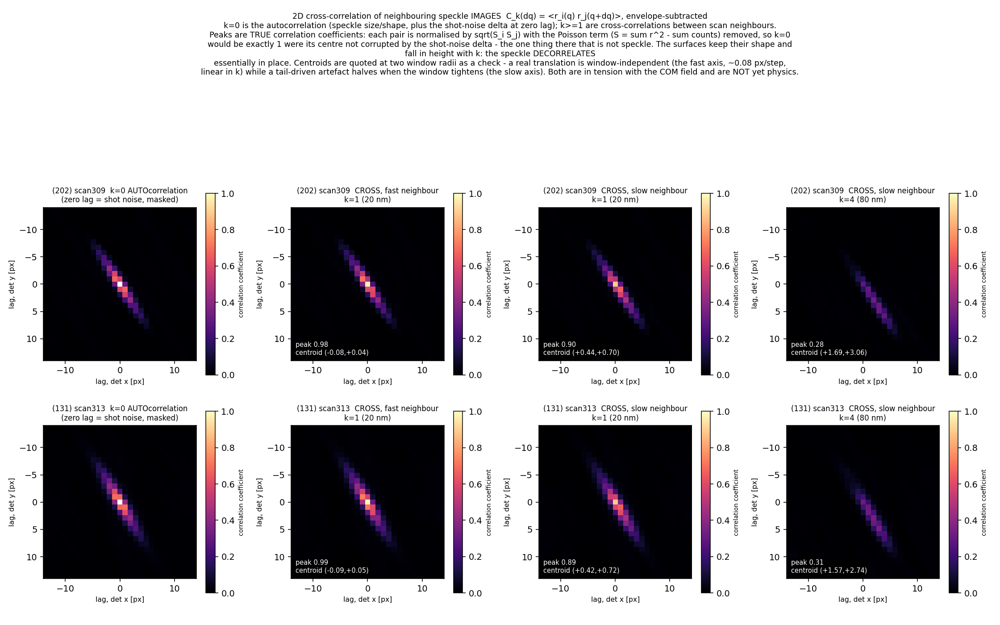
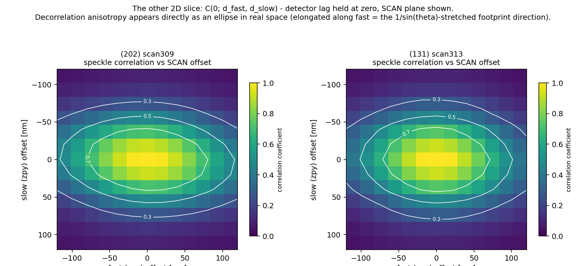

# braggptycho

Analysis of Bragg nanodiffraction scans of epitaxial δ-NbN(111) thin films on sapphire, from the 26-ID nanoprobe. Nothing here reconstructs an image. The scripts compute maps and statistics straight from the stacks of diffraction frames: intensity, Bragg-peak centre of mass, speckle correlation, speckle size, and photon budget.

There are two real scans, both from a 10 nm film:

| Scan | Reflection | θ | Raster |
|---|---|---|---|
| `scan_309_100309` | NbN (202) | 11.2° | 71 × 41 (slow zpy × fast zpx), 20 nm steps |
| `scan_313_100313` | NbN (131) | 18.6° | 71 × 41 |

## Layout

| Directory | Contents |
|---|---|
| `analysis/` | The analysis scripts (table below). |
| `figures/` | Every figure the scripts write. |
| `data/` | Reduced maps and quicklooks for each scan, the synthetic selftest scan, and the raw h5 files (not in git). |
| `docs/` | [`BRIEFING.md`](docs/BRIEFING.md): science context, verified geometry (E ≈ 10 keV, Eiger2 75 µm pixels, R = 522.5 mm) and findings. [`SESSION_LOG_2026-08-20.md`](docs/SESSION_LOG_2026-08-20.md): how the analysis was done. [`ctx.md`](docs/ctx.md): meeting notes and the collaborator's data email. |

## Key figures

**Speckle cross-correlation vs detector lag** (`xcorr_2d.py`). k = 0 is the autocorrelation. For k ≥ 1, each surface correlates a frame with the frame k scan steps away. The peak height gives the decorrelation, the width and shape give the coherently lit extent, and the centroid gives any systematic speckle translation.



**Speckle correlation vs scan offset, at zero detector lag** (`xcorr_2d.py --scan-space`). The decorrelation anisotropy appears as an ellipse in real space.



Other figures: [twin comparison](figures/twin_comparison.png) · [speckle geometry](figures/speckle_geometry.png) · [speckle tracking](figures/speckle_tracking.png) · [G·u phase proxy](figures/gu_proxy.png) · [photon budget](figures/photon_budget.png) · [rocking-curve Fisher information](figures/fisher_rocking.png) · quicklooks for [scan309](data/scan_309_100309_quicklook.png) and [scan313](data/scan_313_100313_quicklook.png) · [synthetic selftest scan](data/synthetic_scan_quicklook.png)

## Data

- **Raw `.h5` files (about 700 MB each) are not in the repo.** Each file holds one detector frame per scan point in `/entry/data/data`, compressed with bitshuffle/LZ4, so `hdf5plugin` is required. Put them in `data/` (gitignored), or point `BRAGG_RAW_DIR` at the directory that holds them.
- **`data/*_maps.npz`** are the reduced maps that `quicklook.py` wrote with default flags. The scripts that read only these maps run without the raw files.
- **`data/synthetic_scan.h5`** is the synthetic twin-domain scan written by `quicklook.py --selftest`.

## Scripts

All in `analysis/`; figures go to `figures/`.

| Script | Input | Output | What it shows |
|---|---|---|---|
| `quicklook.py <scan>.h5` | raw h5 | `<scan>_maps.npz`, `<scan>_quicklook.png` (saved next to the input) | Masks bad pixels and infers the raster grid. Plots the mean pattern, total and max-pixel maps, peak COM, adjacent-frame correlation, and correlation decay. |
| `compare_twins.py` | `data/*_maps.npz` | `twin_comparison.png` | (202) vs (131) side by side. The raw correlation differs between them; after Poisson correction they agree. |
| `gu_proxy.py` | `data/*_maps.npz` | `gu_proxy.png` | Integrates the peak-COM field into a G·u phase-proxy surface. The pm scale is provisional. |
| `photon_budget.py` | `data/*_maps.npz` | `photon_budget.png` | Counts per pixel vs radius from the Bragg peak. |
| `fisher_rocking.py` | none (analytic) | `fisher_rocking.png` | Where on the rocking curve one photon carries the most strain information. |
| `speckle_geometry.py` | raw h5 | `speckle_geometry.png` | Fits the speckle autocorrelation to get detector sampling and the extents of the coherent illumination. Also holds the shared experiment constants (`SCANS`, `GRID`, wavelength, pixel, distance) and speckle-residual helpers the other scripts import. |
| `speckle_tracking.py` | raw h5 | `speckle_tracking.png` | Tracks how far the speckle shifts between neighbouring frames. It fails on this data because of peak locking, a consequence of speckle undersampling. |
| `xcorr_2d.py` | raw h5 | `xcorr_2d.png` | 2D speckle cross-correlation surfaces vs detector lag, for scan neighbours k = 0 (autocorrelation) through k ≥ 1. |
| `xcorr_2d.py --scan-space` | raw h5 | `xcorr_scanspace.png` | Speckle correlation vs scan offset at zero detector lag. |

Every script that has `--selftest` validates itself on synthetic data and needs no real files: `quicklook.py`, `speckle_geometry.py`, `speckle_tracking.py`, `xcorr_2d.py`. The first, second and fourth pass. `speckle_tracking.py` fails selftest 2: undersampled synthetic speckle (grain 0.55 px) puts only 12% of shift estimates at integer lags, while the assertion requires more than twice the well-sampled rate of 11%. So the synthetic model does not yet reproduce the peak locking the script reports on the real data.

## Running

The scripts need `numpy`, `scipy`, `matplotlib`, `h5py` and `hdf5plugin`. Run them from the repo root, because input and output paths are relative to it.

```bash
python analysis/quicklook.py --selftest     # self-checks, no data needed
python analysis/compare_twins.py            # uses data/*_maps.npz

# scripts that read the raw h5 look in data/ (or $BRAGG_RAW_DIR)
python analysis/xcorr_2d.py
python analysis/xcorr_2d.py --scan-space
```
